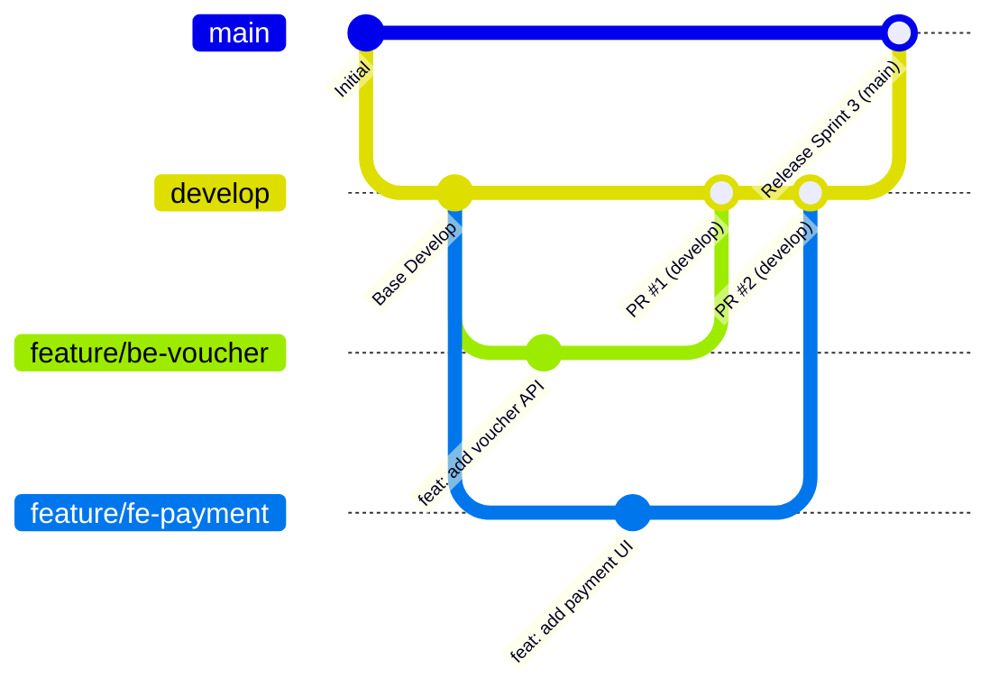

# 🚀 QUY TRÌNH LÀM VIỆC GITFLOW & QUẢN LÝ PULL REQUEST
### Dự Án: Hệ Thống Đặt Vé Xe Khách & Vé Tháng Trực Tuyến SmartBus
---

## I. TẠI SAO CẦN PHẢI TUÂN THỦ GITFLOW?

Trong môi trường doanh nghiệp và các dự án chuyên nghiệp:
1. **Không bao giờ làm việc trực tiếp trên nhánh `main`:**
   - Nhánh `main` là nhánh sản phẩm chính thức (Production). Bất kỳ lỗi nào phát sinh trên `main` đều ảnh hưởng trực tiếp tới hệ thống đang chạy.
   - Toàn bộ quá trình phát triển, tích hợp, kiểm thử tính năng phải diễn ra trên nhánh **`develop`**.
2. **Quy trình Pull Request (PR) là thước đo đánh giá:**
   - Quản lý / Tech Lead đánh giá năng lực và khối lượng công việc của từng thành viên thông qua danh sách **Pull Requests** trên GitHub.
   - PR thể hiện: *Ai làm chức năng gì? Viết code thế nào? Đã tự kiểm thử chưa? Đồng đội review và góp ý những gì?*
   - Thiếu PR và làm thẳng vào `main` sẽ làm mất tính minh bạch và vi phạm quy trình phát triển phần mềm chuẩn.

---

## II. SƠ ĐỒ PHÂN NHÁNH TRONG DỰ ÁN



| Tên Nhánh | Mục Đích Sử Dụng | Quyền Hạn & Quy Định |
| :--- | :--- | :--- |
| **`main`** | Chứa mã nguồn ổn định nhất đã qua nghiệm thu để bàn giao / demo. | **TẠM KHÓA (LOCKED):** Tuyệt đối không ai được commit hay push code trực tiếp lên `main`. Chỉ nhận code khi Leader đóng gói Sprint từ `develop`. |
| **`develop`** | **Nhánh làm việc trung tâm của cả nhóm.** Chứa mã nguồn tích hợp đang phát triển. | Mọi tính năng mới đều phải được merge vào `develop` thông qua **Pull Request**. |
| **`feature/*`** | Nhánh làm tính năng riêng biệt của từng thành viên (VD: `feature/fe-login`, `feature/be-booking`). | Tạo ra từ `develop`, sau khi hoàn thành tạo PR để gộp về `develop`. |
| **`hotfix/*`** | Nhánh sửa lỗi khẩn cấp nếu phát hiện sự cố sau khi đã đóng gói. | Tạo ra từ `main`, sửa xong merge vào cả `main` và `develop`. |

---

## III. QUY TRÌNH 6 BƯỚC LÀM VIỆC CHO TỪNG THÀNH VIÊN

Mỗi khi được giao một nhiệm vụ mới (User Story / Bugfix), thành viên thực hiện nghiêm ngặt theo các bước sau:

### Bước 1: Đồng bộ nhánh `develop` mới nhất về máy
```bash
git checkout develop
git pull origin develop
```

### Bước 2: Tạo nhánh tính năng riêng từ `develop`
Quy tắc đặt tên nhánh:
- Frontend: `feature/fe-<tên-chức-năng>` (VD: `feature/fe-monthly-pass-ui`)
- Backend: `feature/be-<tên-chức-năng>` (VD: `feature/be-cancel-ticket-api`)
- Sửa lỗi: `bugfix/<tên-lỗi>` (VD: `bugfix/fe-fix-tab-collision`)

```bash
git checkout -b feature/fe-seat-selection
```

### Bước 3: Lập trình và tự kiểm thử (Unit Test)
Trước khi commit, thành viên **bắt buộc** phải tự chạy kiểm thử trên máy cục bộ:
1. **Kiểm thử Backend:**
   ```bash
   pytest --ignore=ve-xe-frontend -q
   ```
2. **Kiểm thử Build Frontend:**
   ```bash
   npm --prefix ve-xe-frontend run build
   ```

### Bước 4: Commit và đẩy nhánh lên GitHub
Viết commit message chuẩn theo định dạng Conventional Commits:
- `feat: ...` : Thêm chức năng mới
- `fix: ...` : Sửa lỗi
- `docs: ...` : Sửa tài liệu / readme
- `style: ...` : Sửa CSS / giao diện

```bash
git add .
git commit -m "feat(seats): hoan thien chon ghe 2 tang va giu cho 10 phut"
git push -u origin feature/fe-seat-selection
```

### Bước 5: Mở Pull Request (PR) trên GitHub
1. Truy cập vào kho GitHub của dự án: `https://github.com/dtc245220019-create/Project_TTCS_K7S3_N1_BusTicketing`
2. Nhấn nút **"Compare & pull request"** (hoặc tab **Pull requests** ➔ **New pull request**).
3. **CỰC KỲ QUAN TRỌNG:** Chọn nhánh đích và nhánh nguồn:
   - **base (nhánh đích):** Chọn `develop` *(KHÔNG CHỌN `main`)*
   - **compare (nhánh nguồn):** Chọn nhánh của bạn (ví dụ: `feature/fe-seat-selection`)
4. **Điền thông tin PR theo mẫu tự động:**
   - **Title (Tiêu đề):** `[FE] Hoàn thiện giao diện chọn ghế 2 tầng và giữ chỗ (US02)`
   - **Description (Mô tả):**
     - Nêu rõ những gì bạn đã làm trong nhánh này.
     - Tích chọn checklist kiểm thử đã pass.
     - Đính kèm 1-2 ảnh chụp màn hình chức năng hoạt động hoặc ảnh terminal chạy pass test.
5. Nhìn sang cột bên phải:
   - **Assignees:** Gán chính bản thân mình (người làm).
   - **Reviewers:** Gán Trưởng nhóm hoặc thành viên phụ trách mảng liên quan để duyệt code.

### Bước 6: Review và Thảo luận (Code Review & Comments)
- **Người Review (Leader / Reviewer):**
  - Vào tab **"Files changed"** trên PR để xem từng dòng code.
  - Nếu có chỗ chưa hợp lý: Bấm vào dòng code đó và để lại nhận xét (comment), bấm **"Request changes"**.
  - Nếu code tốt và test đạt: Bấm **"Approve"** và để lại lời nhận xét động viên: `Code chuẩn, UI đẹp, đã test pass. Approved!`.
- **Thành viên sửa theo góp ý:**
  - Tiếp tục sửa trên máy, commit và push lên nhánh feature đó. PR trên GitHub sẽ tự động cập nhật commit mới nhất.
- **Tiến hành Merge:**
  - Nhấn nút **"Merge pull request"** (chọn *Squash and merge* hoặc *Create a merge commit*) để gộp code vào `develop`.

---

## IV. CÁCH TẠO LẠI PULL REQUEST CHO CÁC NHÁNH ĐÃ LÀM (ĐỂ BÁO CÁO QUẢN LÝ)

Hiện tại, các nhánh tính năng của các thành viên trước đây (`feature/fe-update-us08`, `feature/BE-xuat-doanh-thu`, `feature/be3-voucher-feedback`, `feature/fe-updat-homepage`, v.v.) đã được đẩy lên GitHub nhưng chưa có PR lưu vết.

Để quản lý thấy rõ toàn bộ công sức và tiến độ đóng góp của từng thành viên, các bạn hãy tạo lại PR lưu vết như sau:

1. Vào tab **Pull requests** ➔ Bấm **New pull request**.
2. Thiết lập:
   - **base branch:** `develop`
   - **compare branch:** Chọn nhánh tính năng của bạn (ví dụ `feature/BE-xuat-doanh-thu`).
3. Đặt tiêu đề rõ ràng:
   - Ví dụ: `[BE] Xuất báo cáo doanh thu vé xe theo thời gian thực (US11)`
   - Tác giả: Gán tên bạn vào ô **Assignees**.
4. Viết phần mô tả chi tiết:
   - Bảng cơ sở dữ liệu đã tác động (`payments`, `bookings`, `tickets`).
   - Các API endpoint đã viết (`GET /api/v1/admin/revenue/export`).
   - Kết quả test API.
5. Nhấn **Create pull request**.
6. Leader hoặc thành viên khác vào tab PR đó, bấm tab **Files changed**, thêm comment đánh giá nghiệm thu chức năng rồi bấm **Approve** và **Merge**.
👉 **Kết quả:** Trên GitHub của nhóm sẽ xuất hiện đầy đủ lịch sử Pull Request chuyên nghiệp, có từng tác giả, có nhận xét phản biện, đáp ứng 100% tiêu chuẩn Gitflow mà Quản lý yêu cầu!

---

## V. HƯỚNG DẪN THIẾT LẬP KHÓA NHÁNH `main` TRÊN GITHUB (DÀNH CHO TRƯỞNG NHÓM)

Để tránh trường hợp thành viên lỡ tay `git push` thẳng lên `main`:
1. Vào repository trên GitHub ➔ Chọn **Settings** (Bánh răng).
2. Chọn mục **Branches** ở thanh bên trái ➔ Nhấn **Add branch protection rule**.
3. Tại ô **Branch name pattern**, nhập: `main`
4. Tích chọn các ô sau:
   - [x] **Require a pull request before merging** (Bắt buộc phải qua PR mới được vào main).
     - [x] **Require approvals** (Chọn ít nhất 1 người duyệt).
   - [x] **Do not allow bypassing the above settings** (Áp dụng cho cả Admin/Leader).
5. Nhấn **Create** để lưu lại.

Làm tương tự một quy tắc bảo vệ cho nhánh `develop` (bắt buộc qua PR) để đảm bảo quy trình Gitflow hoạt động hoàn hảo!
